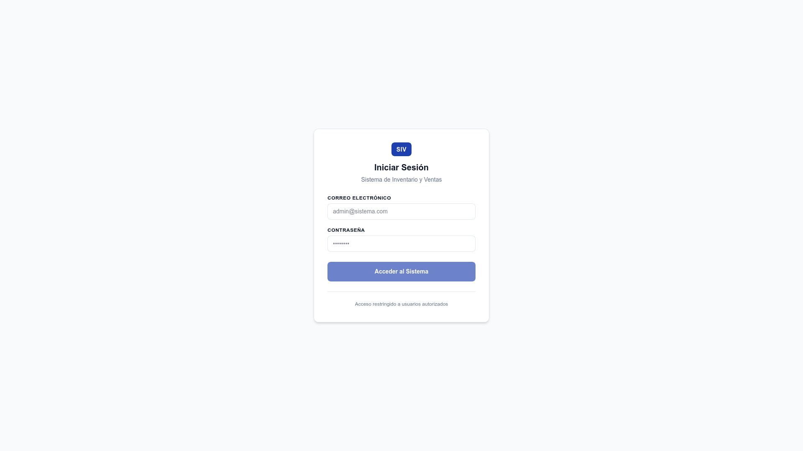
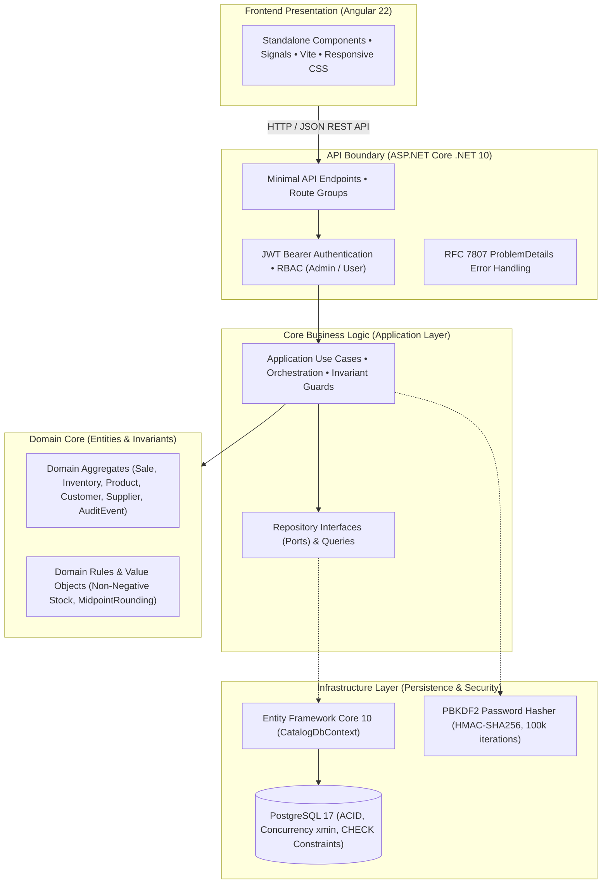
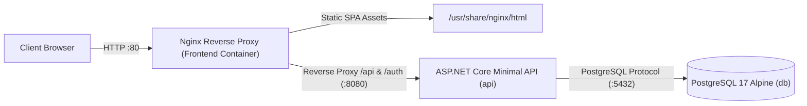

# InventorySalesSystem

> **Sistema de Inventario y Ventas** — Enterprise Commercial Inventory & Sales Management

[](https://dotnet.microsoft.com/)
[](https://angular.dev/)
[](https://www.typescriptlang.org/)
[](https://www.postgresql.org/)
[](https://www.docker.com/)

An enterprise-grade commercial inventory and sales management system built with **Clean Architecture**, **ASP.NET Core Minimal APIs (.NET 10)**, **Entity Framework Core 10**, **PostgreSQL 17**, and an **Angular 22** standalone frontend.

Designed with rigorous domain-driven invariants, atomic sales confirmation, strict concurrency controls, forensic auditability, role-based access control, and zero paid UI library dependencies.

---

## 📋 Table of Contents

- [Business Problem & Core Purpose](#-business-problem--core-purpose)
- [System Features & Modules](#-system-features--modules)
- [Application Walkthrough & UI Screens](#-application-walkthrough--ui-screens)
- [Architecture & Technology Stack](#-architecture--technology-stack)
- [Repository Structure](#-repository-structure)
- [Prerequisites](#-prerequisites)
- [Local Setup & Execution](#-local-setup--execution)
- [Database Migrations](#-database-migrations)
- [Authentication & Initial User Setup](#-authentication--initial-user-setup)
- [API Documentation](#-api-documentation)
- [Testing & Quality Verification](#-testing--quality-verification)
- [Current Limitations & Roadmap](#-current-limitations--roadmap)

---

## 🎯 Business Problem & Core Purpose

Commercial trading businesses frequently suffer from inventory discrepancies, negative stock conditions, and inaccurate revenue accounting when sales and inventory operations are decoupled or calculated asynchronously.

This system guarantees business integrity through server-authoritative invariants:

1. **Non-Negativity Invariant (`BR-INV-001`)**: Product inventory stock can never become negative under any circumstance, even during concurrent checkout attempts.
2. **Atomic Sale Confirmation (`BR-SAL-004`)**: The transition of a sale from `Draft` to `Confirmed` executes as an atomic database transaction. Stock is deducted, inventory movements are generated with sale references, and revenue is recognized simultaneously. If any line item lacks stock, the entire confirmation aborts with HTTP 409 Conflict without side effects.
3. **Immutability of Confirmed Sales (`BR-SAL-005`)**: Once confirmed, a sale is locked against line additions, modifications, customer reassignment, or deletion.
4. **Append-Only Forensic Audit Trail (`BR-AUD-001`, `BR-AUD-002`)**: System operations automatically generate immutable audit events with user attribution, UTC timestamps, and sanitized metadata (passwords, tokens, and keys are strictly prohibited from logs).
5. **Authoritative Financial Calculations (`BR-REP-004`)**: All tax calculations (13% VAT), subtotals, rounding (`MidpointRounding.AwayFromZero`), and realized revenues are computed server-side.

---

## 🚀 System Features & Modules

### 1. Catalog Management (Categories & Products)
- Category management with hierarchical protection: categories with linked products cannot be deleted (HTTP 409 Conflict).
- Product management with unique alphanumeric SKU identifiers, name, and category association.
- Historical data preservation: products are deactivated rather than deleted to preserve sales history and inventory movement traceability.

### 2. Customers & Suppliers Management
- Distinct domain entities with unique tax identification codes (`Cedula`, `RUT`, `NIT`).
- Supplier management with contact name and address tracking.
- Deletion is prohibited to maintain referential integrity; active/inactive status toggles control operational availability.

### 3. Inventory Management & Movement Traceability
- Real-time stock status monitoring by product and category.
- **Stock Entries**: Record inbound goods with immutable supplier snapshots at reception time.
- **Stock Exits**: Controlled outbound adjustments with immediate overdraft prevention.
- **Inventory Adjustments**: Signed-delta manual reconciliations (+N or -N) with mandatory audit justification.
- Complete movement traceability history with user attribution and transaction links.

### 4. Sales Workflow & Receipts
- Step-by-step sale builder: Draft creation, customer selection (registered customer or anonymous walk-in / Consumidor Final).
- Dynamic detail line additions, quantity updates, and line removals with real-time recalculation of subtotal, tax, and total.
- Atomic sale confirmation with inventory validation.
- Printable, clean receipt view formatted for point-of-sale thermal printers or standard paper.

### 5. Reports & Analytics Dashboard
- **Sales Summary**: Total transactions, confirmed transactions, realized revenue, and itemized sales tables.
- **Product Sales Performance**: Best-selling products ranked by units sold and gross revenue contribution.
- **Inventory Status**: Real-time stock levels with categorical badges (`InStock`, `LowStock`, `OutOfStock`).
- **Movement Traceability**: Aggregated inventory flow (total units in, total units out, adjustment deltas, net quantity balance).

### 6. Audit Log & Security Monitoring
- Forensic audit event stream sorted in descending chronological order.
- Multi-parameter filtering by `eventType`, `entityName`, `entityId`, `userId`, and UTC date range.
- Detail inspection modal displaying formatted, sanitized JSON metadata.

### 7. Authentication & Authorization (RBAC)
- Short-lived JWT Bearer access tokens (15-minute expiration) stored securely in browser `sessionStorage`.
- Password hashing using PBKDF2 with HMAC-SHA256, 100,000 iterations, and unique 128-bit cryptographic salts.
- Role-based authorization policies:
  - `Admin`: Full access to mutations, financial reports, and system audit logs.
  - `User`: Operational access to stock status, movement traceability, customer/product listings, and receipt lookups.

---

## 🖥️ Application Walkthrough & UI Screens

The Angular 22 standalone frontend delivers a responsive, enterprise-grade user experience built without third-party component libraries.


*Figure 1: Authentic SIV Angular 22 standalone authentication interface (`/login`) featuring client-side reactive validation and session storage isolation.*

| Screen / Feature | Route | Access | Key Capabilities | Visual Preview |
| :--- | :--- | :--- | :--- | :--- |
| **Authentication** | `/login` | Public | JWT credential authentication, reactive validation, secure session establishment | [Captured (01-login.png)](docs/screenshots/01-login.png) |
| **Executive Dashboard** | `/dashboard` | All | Real-time system KPI summary cards, operational shortcuts, recent alerts | [Reproduction Guide](docs/screenshots/README.md#screen-inventory--filename-specifications) |
| **Categories Management** | `/categories` | All (Mutations: Admin) | Hierarchical category protection (HTTP 409 guard against in-use deletion) | [Reproduction Guide](docs/screenshots/README.md#screen-inventory--filename-specifications) |
| **Products Catalog** | `/products` | All (Mutations: Admin) | SKU management, category filter, soft deactivation, search | [Reproduction Guide](docs/screenshots/README.md#screen-inventory--filename-specifications) |
| **Customer Registry** | `/customers` | All (Mutations: Admin) | Unique tax IDs (`Cedula`/`RUT`/`NIT`), contact info, active status toggling | [Reproduction Guide](docs/screenshots/README.md#screen-inventory--filename-specifications) |
| **Supplier Registry** | `/suppliers` | All (Mutations: Admin) | Vendor management, contact person, phone, address, status toggling | [Reproduction Guide](docs/screenshots/README.md#screen-inventory--filename-specifications) |
| **Inventory Stock Status** | `/inventory` | All | Real-time stock levels with categorical badges (`InStock`, `LowStock`, `OutOfStock`) | [Reproduction Guide](docs/screenshots/README.md#screen-inventory--filename-specifications) |
| **Movement Traceability** | `/inventory` | All | Append-only audit trail of entries, exits, signed adjustments, supplier snapshots | [Reproduction Guide](docs/screenshots/README.md#screen-inventory--filename-specifications) |
| **Sales Builder (POS)** | `/sales` | Admin | Draft sale builder, walk-in/customer selection, authoritative server arithmetic | [Reproduction Guide](docs/screenshots/README.md#screen-inventory--filename-specifications) |
| **Printable Receipt** | `/sales` | All | Thermal-printer-ready receipt view with UTC timestamp, line items, and VAT | [Reproduction Guide](docs/screenshots/README.md#screen-inventory--filename-specifications) |
| **Reports & Analytics** | `/reports` | Role-Gated (Admin: Financial) | Itemized sales summary, best-sellers ranking, CSS revenue progress bars | [Reproduction Guide](docs/screenshots/README.md#screen-inventory--filename-specifications) |
| **Forensic Audit Log** | `/audit` | Admin | Immutable event stream, multi-parameter filtering, formatted JSON metadata | [Reproduction Guide](docs/screenshots/README.md#screen-inventory--filename-specifications) |

> 📷 **Screenshot Capture Status**: The authentication screen (`01-login.png`) was captured directly from the live running Angular application at 1920×1080 in light mode. Remaining screens require active session authentication and test data; complete reproduction steps and specifications are documented in [`docs/screenshots/README.md`](docs/screenshots/README.md).

---

## 🏗️ Architecture & Technology Stack

The project follows strict **Clean Architecture** dependency rules: all dependencies point inward toward the Domain model.



### Production Container Topology



### Technology Matrix

| Layer | Technology | Version | Purpose |
| :--- | :--- | :--- | :--- |
| **Backend Runtime** | C# / .NET | 10.0 | High-performance, strongly typed enterprise backend |
| **API Framework** | ASP.NET Core Minimal APIs | 10.0 | Lightweight, low-overhead HTTP routing |
| **ORM / Persistence** | Entity Framework Core & Npgsql | 10.0.12 / 10.0.3 | Relational mapping, concurrency tokens, migrations |
| **Database** | PostgreSQL | 17 (Alpine) | ACID transactions, row-level locks, CHECK constraints |
| **Frontend Framework** | Angular | 22.2.3 | Modern component model, signals, standalone routing |
| **Frontend Language** | TypeScript | 6.0.3 | Strict type safety and compilation |
| **Tooling & Bundler** | Angular CLI & Vite | 22.2.4 | Rapid HMR, strict bundle budgets (< 4kB per component) |
| **Containerization** | Docker & Docker Compose | 24+ | Isolated local infrastructure setup |

---

## 📁 Repository Structure

```text
SistemaInventarioVentas/
├── docker-compose.yml              # Local PostgreSQL 17 infrastructure definition
├── .env.example                    # Safe environment configuration template
├── .gitignore                      # Git exclusion rules for .NET, Angular, secrets & OS
├── SistemaInventarioVentas.slnx    # Visual Studio / .NET 10 solution
├── src/
│   ├── SistemaInventarioVentas.Domain/           # Entities, Value Objects, Domain Invariants
│   ├── SistemaInventarioVentas.Application/      # Use Cases, Interfaces, Application Models
│   ├── SistemaInventarioVentas.Infrastructure/   # EF Core DbContext, Repositories, Security
│   └── SistemaInventarioVentas.API/              # Minimal API Endpoints, JWT Config, Middleware
├── tests/
│   ├── SistemaInventarioVentas.Domain.Tests/          # Unit tests for domain invariants
│   ├── SistemaInventarioVentas.Application.Tests/     # Use case logic & validation tests
│   ├── SistemaInventarioVentas.Infrastructure.Tests/  # EF Core persistence & concurrency tests
│   └── SistemaInventarioVentas.API.Tests/             # API endpoint integration tests
├── frontend/
│   ├── proxy.conf.json             # Dev server proxy routing /api and /auth to Kestrel
│   ├── src/
│   │   ├── app/
│   │   │   ├── core/               # AuthService, Interceptors, Guards, Models & Services
│   │   │   ├── features/           # Feature components (Catalogs, Sales, Inventory, Reports, Audit)
│   │   │   ├── shared/             # Reusable UI components (Modals, Alerts, Indicators)
│   │   │   └── app.routes.ts       # Lazy-loaded route hierarchy with AuthGuard & AdminGuard
│   │   └── environments/           # Environment configurations (development & production)
│   └── package.json                # Angular scripts and dependencies
├── scripts/
│   └── e2e-integration-validation.mjs  # Automated 159-assertion real-backend E2E test runner
└── docs/                           # Architecture, business rules, and decision records
```

---

## ⚙️ Prerequisites

Ensure the following tools are installed before setting up the project locally:

- **.NET 10.0 SDK** (v10.0.100 or later): `dotnet --version`
- **EF Core CLI Tools** (v10.0.0 or later): `dotnet tool install --global dotnet-ef`
- **Node.js** (v20+ LTS or v24+ LTS): `node --version`
- **npm** (v10+ or v11+): `npm --version`
- **Docker & Docker Compose**: `docker --version` and `docker compose version`

---

## 🚀 Local Setup & Execution

### Step 1: Clone the Repository
```bash
git clone https://github.com/CristiamSanchez/InventorySalesSystem.git
cd InventorySalesSystem
```

### Step 2: Environment Configuration
Copy the sample environment file:
```bash
cp .env.example .env
```

Review the values in `.env`. The default settings work out of the box for local development:
```env
POSTGRES_USER=postgres
POSTGRES_PASSWORD=postgres
POSTGRES_DB=inventario
POSTGRES_PORT=5432
ConnectionStrings__InventoryDatabase=Host=localhost;Port=5432;Database=inventario;Username=postgres;Password=postgres
Authentication__Jwt__Issuer=SistemaInventarioVentas.API
Authentication__Jwt__Audience=SistemaInventarioVentas.Client
Authentication__Jwt__SigningKey=your_at_least_32_bytes_super_secret_jwt_key_here!
Authentication__Jwt__AccessTokenLifetimeMinutes=15
ASPNETCORE_ENVIRONMENT=Development
ASPNETCORE_URLS=http://localhost:5008
```

> **Tip**: If port `5432` is already in use by another local database on your machine, set `POSTGRES_PORT=5439` in `.env` and update the port in `ConnectionStrings__InventoryDatabase` to match (`Port=5439`).

---

### Step 3: Start PostgreSQL with Docker Compose
Start the isolated PostgreSQL 17 container:
```bash
docker compose up -d
```

Verify that the container is healthy:
```bash
docker compose ps
```

To stop the database container when finished:
```bash
docker compose down
```

---

### Step 4: Apply Database Migrations
Run the EF Core migrations against the database. Because the database context factory is hosted in the Infrastructure layer, specify `SistemaInventarioVentas.Infrastructure` as both the project and startup project:

```bash
export ConnectionStrings__InventoryDatabase="Host=localhost;Port=5432;Database=inventario;Username=postgres;Password=postgres"

dotnet ef database update \
  --project src/SistemaInventarioVentas.Infrastructure \
  --startup-project src/SistemaInventarioVentas.Infrastructure
```

All 10 migrations will be applied, establishing the database tables, foreign keys, indexes, and concurrency tokens.

---

### Step 5: Start the Backend API
Export the required runtime environment variables and launch the API:

```bash
export ConnectionStrings__InventoryDatabase="Host=localhost;Port=5432;Database=inventario;Username=postgres;Password=postgres"
export Authentication__Jwt__Issuer="SistemaInventarioVentas.API"
export Authentication__Jwt__Audience="SistemaInventarioVentas.Client"
export Authentication__Jwt__SigningKey="your_at_least_32_bytes_super_secret_jwt_key_here!"
export Authentication__Jwt__AccessTokenLifetimeMinutes="15"
export ASPNETCORE_ENVIRONMENT="Development"
export ASPNETCORE_URLS="http://localhost:5008"

dotnet run --project src/SistemaInventarioVentas.API
```

The API will start and listen on `http://localhost:5008`.

---

### Step 6: Start the Frontend Application
In a separate terminal window, navigate to the `frontend/` directory, install dependencies, and start the development server:

```bash
cd frontend
npm install
npm start
```

The Angular dev server will start at `http://localhost:4200`. Requests to `/api` and `/auth` are automatically reverse-proxied to the backend API at `http://localhost:5008` via `proxy.conf.json`.

---

### Alternative: Full-Stack Containerized Execution (Production Compose)

To run the complete 3-tier application stack in isolated containers (PostgreSQL 17, ASP.NET Core API on port 8080, and Angular served via Nginx on port 80):

1. **Start the Complete Stack**:
   ```bash
   docker compose -f docker-compose.prod.yml up -d --build
   ```

2. **Apply Database Migrations**:
   *(Note: Compose service dependencies and healthchecks ensure PostgreSQL is ready, but do not automatically apply EF Core schema migrations).*
   ```bash
   export ConnectionStrings__InventoryDatabase="Host=localhost;Port=5432;Database=inventario;Username=postgres;Password=postgres"

   dotnet ef database update \
     --project src/SistemaInventarioVentas.Infrastructure \
     --startup-project src/SistemaInventarioVentas.Infrastructure
   ```

3. **Access the Containerized Application**:
   - Web Application & API Gateway (Nginx): `http://localhost` (or `http://localhost:${FRONTEND_PORT:-80}`)
   - API endpoints (`/api` and `/auth`) are routed internally to the API container on port 8080.

4. **Shutdown the Stack**:
   ```bash
   docker compose -f docker-compose.prod.yml down
   ```

---

## 🔐 Authentication & Initial User Setup

To guarantee security in production, the system creates newly registered accounts in an `Inactive` state (`IsActive = false`) with the base `User` role. Accounts must be activated before they can log in.

### Creating an Initial Administrator Account:

1. **Register the user** via HTTP request (while the API is running):
```bash
curl -X POST http://localhost:5008/auth/register \
  -H "Content-Type: application/json" \
  -d '{
    "name": "Administrador",
    "email": "admin@empresa.com",
    "password": "Password123!"
  }'
```
*Response (HTTP 201 Created):*
```json
{
  "userId": "a1b2c3d4-e5f6-7890-abcd-ef1234567890",
  "isActive": false
}
```

2. **Activate the account and grant the `Admin` role** in the database:
```bash
docker exec -it sistema-inventario-db psql -U postgres -d inventario -c \
  "UPDATE users SET \"IsActive\" = true, \"Roles\" = '[1, 0]'::jsonb WHERE \"Email\" = 'admin@empresa.com';"
```
*(In the database, role values correspond to `0 = User` and `1 = Admin`).*

3. **Log in to the Web Application**:
Navigate to `http://localhost:4200/login` and log in using:
- **Email**: `admin@empresa.com`
- **Password**: `Password123!`

---

## 📖 API Documentation

When running in `Development` mode (`ASPNETCORE_ENVIRONMENT=Development`), ASP.NET Core automatically exposes the OpenAPI 3.0 specification:

- **OpenAPI Document**: `http://localhost:5008/openapi/v1.json`

Endpoints conform strictly to RFC 7807 (`application/problem+json`) for standardized validation and error responses.

---

## 🧪 Testing & Quality Verification

The project includes automated test coverage across all architectural layers:

### 1. Backend Automated Tests (xUnit)
Runs 767+ automated tests across Domain, Application, Infrastructure, and API projects:
```bash
dotnet test
```

To test individual layers:
```bash
dotnet test tests/SistemaInventarioVentas.Domain.Tests/
dotnet test tests/SistemaInventarioVentas.Application.Tests/
dotnet test tests/SistemaInventarioVentas.Infrastructure.Tests/
dotnet test tests/SistemaInventarioVentas.API.Tests/
```

### 2. Frontend Unit Tests (Vitest)
Executes 181 frontend unit tests across all services, interceptors, guards, and components:
```bash
cd frontend
npm test -- --watch=false
```

### 3. End-to-End Integration Validation
Executes the automated end-to-end integration suite ([`scripts/e2e-integration-validation.mjs`](file:///home/cristiamsanchez/Documents/VSCodeProjects/SistemaInventarioVentas/scripts/e2e-integration-validation.mjs)) executing 159 assertions against the live running API, Angular reverse proxy, and PostgreSQL:
```bash
cd frontend
npm run test:e2e
```

### 4. Frontend Production Build
Verifies ahead-of-time compilation, tree-shaking, and bundle size budget compliance:
```bash
cd frontend
npm run build
```

### 5. Continuous Integration (GitHub Actions)
The repository includes an automated CI workflow ([`.github/workflows/ci.yml`](.github/workflows/ci.yml)) configured to run on every push and pull request targeting `main`:
- **Backend Job**: Restores, builds (`Release`), and executes all 767+ xUnit tests with Testcontainers.
- **Frontend Job**: Installs dependencies (`npm ci`), runs non-interactive unit tests (`npm test -- --watch=false`), and builds the production Angular distribution.

---

## 🗺️ Current Limitations & Roadmap

- **Administrative User Management UI**: Account activation currently occurs via direct database administrator command; a dedicated user management module is planned.
- **Server-Side Pagination**: Catalog, movement, and audit views currently utilize client-side search and filtering; server-side keyset/offset pagination will be introduced for high-volume deployments.
- **Continuous Deployment (CD)**: Automated deployment to cloud staging or production environments (e.g. Kubernetes, AWS ECS, or Azure Container Apps).

---

## 👤 Author & Methodology

Developed by **Cristiam Sanchez** utilizing the **ProgramingAssistedAI** methodology — a rigorous engineering approach combining domain-driven design, Clean Architecture invariants, and automated verification gates.